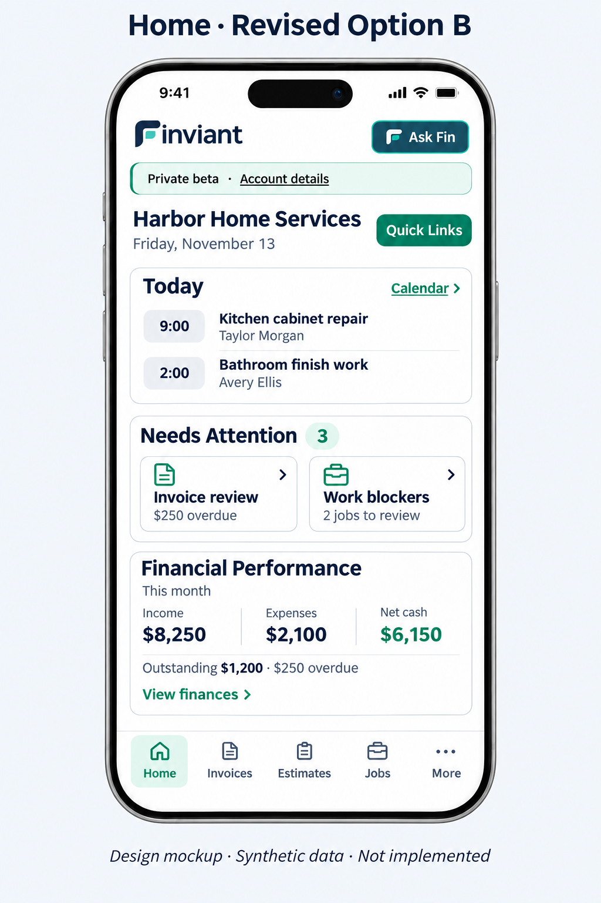

# Home — revised Option B

The owner approved revised Option B and requested beta deployment after the invoice release. PR114 is already merged and verified on both beta domains. This change starts from that release and retains its invoice controls and recurring setup.

## Approved composition

- Keep Quick Links beside the business heading and the existing Ask Fin entry.
- Today shows the first two active scheduled visits with local times, job names and customer names. Calendar opens the full existing calendar. Further visits, reminders, connected events and calendar issues remain reachable and visible as appropriate.
- Needs Attention uses the same icon-and-chevron tile treatment as Job Management → Work: Invoice review and Work blockers. Invoice overdue money reuses the verified Financial Performance receivables result, rather than adding another finance query. Waiting approvals, scheduling follow-ups, payment processing safeguards and reconciliation remain in the existing review queues.
- Financial Performance shows the current allowed cash period, income, expenses, net cash and outstanding/overdue balances. Free-plan history limits remain enforced. View finances opens the existing periods, chart, transaction drill-down, entry forms and workbook route.
- Configured company logos and the shared Ask Fin header position remain visible and stable between workspaces. The bottom navigation, private-beta/account disclosure, roles, unsaved-edit protections, explicit send/charge confirmations and underlying service APIs are retained. Manual Home refresh is available inside Quick Links.

## Preserved behavior

Summary controls expand their existing views in place. Back controls restore keyboard focus to the initiating control. Returning from a document preserves the saved billing queue filter/page. Returning from another calendar week restores Today's date. Loading and failed queues do not display a false all-clear balance or count. Payment reconciliation is highlighted before additional customer follow-up.

No database migration, hosted-data edit, provider activation, customer message or payment operation is needed for this release. No public launch or physical-device acceptance is claimed.

## Validation and review

`tests/e2e/home-revised.spec.mjs` exercises the approved composition at 320, 390, 430 and 1440 pixels, accessibility, focus, customer/job destinations, worker restrictions, missing queues and payment-review routing using synthetic data. `tests/e2e/home-screen.spec.mjs` retains chooser, navigation and deeper calendar/financial coverage. Existing workflow regressions explicitly open the relevant Home card before exercising its detailed tools.

The focused Home workflow records Chromium/WebKit results and phone screenshots in `home-revised-chromium` and `home-revised-webkit` artifacts. Local screenshots are under `/workspace/finviant-setup/home-revised-screenshots`. Required complete release checks must pass on the final candidate before merge or beta promotion.

The older PR107 Home draft remains separate; this change implements the owner's newer approved composition without importing its unmerged changes. The simplified three-screen invoice-creation mockup remains a proposal.

## Owner-approved visual reference

