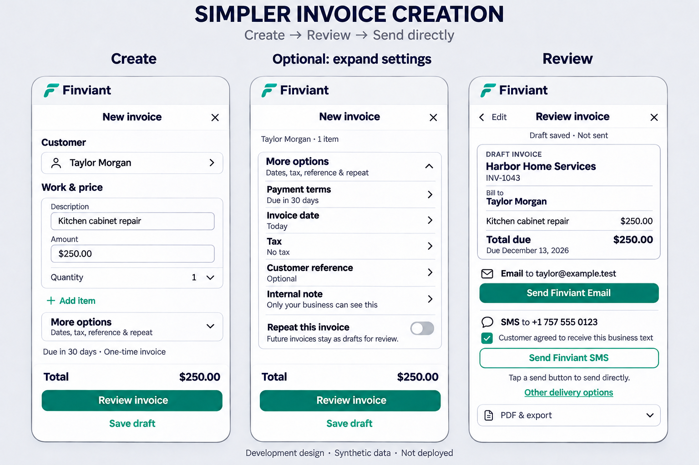

# Simplified invoice creation and direct sending

Implemented in development on `ux/invoice-simple-creation-20261113`, based on beta commit `e6b2476a4a39194a18ec43fa310da408b5947cc5` and retaining the verified Home release receipt. This is a new invoice-creation implementation; it has not been released to beta.

The owner approved the simplified creation recommendations, requested implementation and new mockups, then explicitly replaced Choose delivery with direct Finviant Email/SMS actions. Opening Review saves one draft and prepares its canonical PDF; it never sends. Clicking an available Send action sends directly through the existing workflow, without a delivery chooser or another confirmation screen. SMS retains its existing recipient-consent requirement.

## Entry and optional details

Customer, description and amount are the main inputs. A selected customer appears as one card with name and email, rather than a repeated label, input and Change button. New customers can be saved with just a name; company/contact details are optional. Quantity starts at one and expands when needed. Multiple items retain quantities, per-item tax and remove/undo behavior.

One Add item chooser supports manual entry, saved services and saved packages, copying their prices and tax without modifying the catalogue. Existing catalogue management stays within its optional management disclosure. More options expands within the form, rather than adding a wizard screen. It contains payment terms, invoice date, one tax section with per-item overrides, customer reference, internal note, service location and owner-only recurring/pricing options. A custom due-date field appears only when needed. Existing tax defaults, due-on-invoice-date behavior and payment settings remain unchanged; the database has no separate saved payment-terms preference, so this change does not invent one.

Save draft bypasses Review and needs no delivery contact. Review has no duplicate Save action or Choose delivery button. Existing recurring schedule management moves to Invoice & Estimate Setup; Repeat this invoice still opens the existing explicit schedule confirmation after saving. Future occurrences remain drafts.

## Jobs and approved prices

A job handoff carries the customer, work and location. An existing linked invoice opens directly, preserving its saved prices and avoiding duplicate creation. Jobs sourced from an approved estimate use the existing estimate review/conversion path, preserving approved lines and deposit/billing rules. A standalone job without a saved agreed price leaves the amount blank for the user; material costs are never guessed as customer prices.

## Review, delivery and recovery

Review shows the customer, work, exact decimal totals, tax, assigned invoice number when supplied by the server, and due date. PDF & export retains the canonical stored PDF, download and recovery tools. Send actions wait for the verified PDF and carry its reviewed revision ID. Uncertain email retries reuse the original operation and invoice. Closing or editing a saved review does not create a second invoice. Customer/item button selections mark the draft as edited; unsaved selections require discard confirmation, while a saved review closes cleanly. Native PDF sharing remains within PDF & export and does not record an invoice send.

Direct Finviant actions appear only for the configured plan/channel and a valid recipient. An unavailable provider is not presented as an available send action. Supported personal-app alternatives are labelled Open email app/Open text app and retain explicit app-handoff confirmation. Fresh setup/recipient checks and provider restrictions remain in the existing services. No provider was activated, hosted data modified, message sent or payment charged during implementation; all browser service operations are synthetic.

## Review artifacts and validation

The design reference uses illustrative terms and provider readiness. Actual rendered captures use synthetic fixtures and are under `tmp/invoice-simple/`, with copies in `/workspace/finviant-setup/invoice-simple-screenshots/`. Viewports cover 320, 390, 430 and 1440 pixels. The validation receipt is [here](evidence/2026-11-13-invoice-simple-creation.json). It distinguishes local implementation, Chromium/DOM checks and still-pending release/physical-device/provider gates.

The previous three-screen proposal is superseded by this two-stage Create → Review flow with optional inline settings and direct Send actions. All existing launch records and acceptance criteria remain; implementation is not a beta release or physical-device/live-provider acceptance.

## Actual rendered phone screens

These are browser captures of the implemented form using synthetic data, separate from the illustrative design reference.

- [Create](reference/invoice-simple-create-390.png)
- [Expanded options](reference/invoice-simple-options-390.png)
- [Review with direct Email/SMS](reference/invoice-simple-review-390.png)
