# Phone reference comparison

Scope: layout-only correction to the existing Job Management phone screens. Beta publication is held until rendered comparison and required checks pass. PR97 and the earlier task queue remain paused.

## What was corrected

- WebKit’s native selector exposed a grid intrinsic-width overflow at 320px (361px document scroll width despite fitting visible boxes). The selector label uses an explicit `minmax(0, 1fr)` column and contains the native selected-value overflow. The native picker choices and full card title remain available; no page-level clipping masks overflow. Long-title fixtures cover the reported delivery-check title pattern.
- The phone shell fills the available viewport, with device safe-area padding and full-screen forms. It does not scale down the page to fit its height.
- Summary uses the reference's joined job picker/card, status/title hierarchy, concise next action and three equal-width shortcuts. An inherited 125px Directions minimum width was corrected.
- Work uses four large outlined buttons; Billing and Records use aligned rows with icon dividers. Records reuses the existing activity and Job details actions.
- Detail screens share heading, field, button and card styles. Tasks use outlined cards and an expandable completed group; completion, Edit and Remove controls remain available.
- Scheduling form actions now use the same sizing as task/material forms. Inline expense, budget and time-entry forms remain inline and retain their existing save behavior.
- Phone body typography reuses the repository’s existing licensed DejaVu Sans regular/bold font, served locally with no font service. Branding remains unchanged.
- The task-title selector now matches the rendered `label > span`; Job actions styling now matches its actual disclosure element. Financial rows and activity text no longer inherit small desktop typography.

## Comparison method and limits

Five approved reference images are compared with populated, synthetic rendered application screenshots at 390 CSS pixels. The phone hardware/status frame is removed from the reference, and both content widths are normalized. Browser captures include the full scrollable page; their fixed navigation appears at the original viewport position. Different content, available permissions and viewport heights are not treated as pixel errors.

This is a visual review, not a percentage similarity score. The app retains accessible touch targets, full service addresses, actual crew names, notes, account details, queue browsing, Job actions and Back controls even where the concept image omits them. No invented balance, worker, job status or feature is introduced to reproduce decorative reference content.

| Screen | Required visual treatment |
|---|---|
| Summary | Compact chrome; joined picker/card; bold selected job; mint status; green next action; four tabs; equal quick buttons |
| Work | Compact selected-job identity; four substantial cards; consistent icons, text and spacing; next visit; existing Job actions |
| Billing | Readable authoritative financial rows; three aligned action rows; no fabricated mockup balances |
| Records | Two record rows; mint latest-activity heading; existing Job details action; consistent outlined controls |
| Tasks | Strong title and progress; full-width action row; outlined active tasks; accessible completed disclosure |
| Other details/forms | Same type hierarchy and controls across visits, materials, photos/expenses, costs, changes, activity, reports and editors |

## Verification receipt

Visual assessment: the five main reference compositions are closely matched in hierarchy, card/button treatment and navigation. The nine detail destinations and their captured forms/inline editors retain the same layout language. Intentional differences include full addresses, truthful financial values, existing Remove/Job actions/Back controls, native input widgets and scrolling to retain usable touch targets. The app is not compressed to force all content into one screen.

The initial corrected app `73f98993489662447c7a0a96b58fff9a909021f5` passed all 18 focused cases in Chromium and all 18 in WebKit ([run 43218427542](https://github.com/Velnu38/Velnu/actions/runs/43218427542)). TypeScript and nine operational DOM scenarios pass. Final screenshot review then identified the scheduling Close button as smaller than other editors; candidate `73534fdf49537ea1ea010d5ef58dc66d88f26afb` aligns it to the same 44px control. The corrected app passed all 36 focused cases again in [run 43219850066](https://github.com/Velnu38/Velnu/actions/runs/43219850066): Chromium job 131188287451 and WebKit job 131188287020. Refreshed screenshots were inspected before release; the scheduling Close controls now match. Evidence artifacts: Chromium 13944597861 and WebKit 13945207361. Required CI and beta deployment remain pending. No physical iPhone/Android or owner acceptance is claimed. Emulated layout/visual viewport measurements cannot certify the owner's particular Safari/in-app zoom condition.

## Reference and rendered comparisons

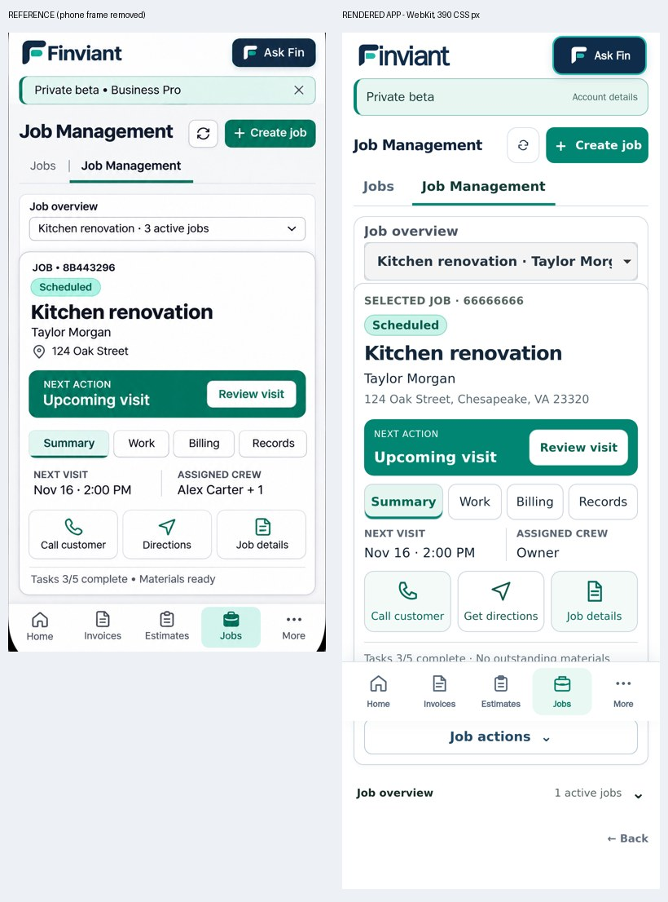

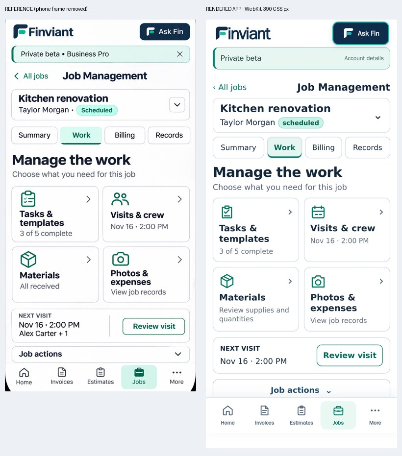

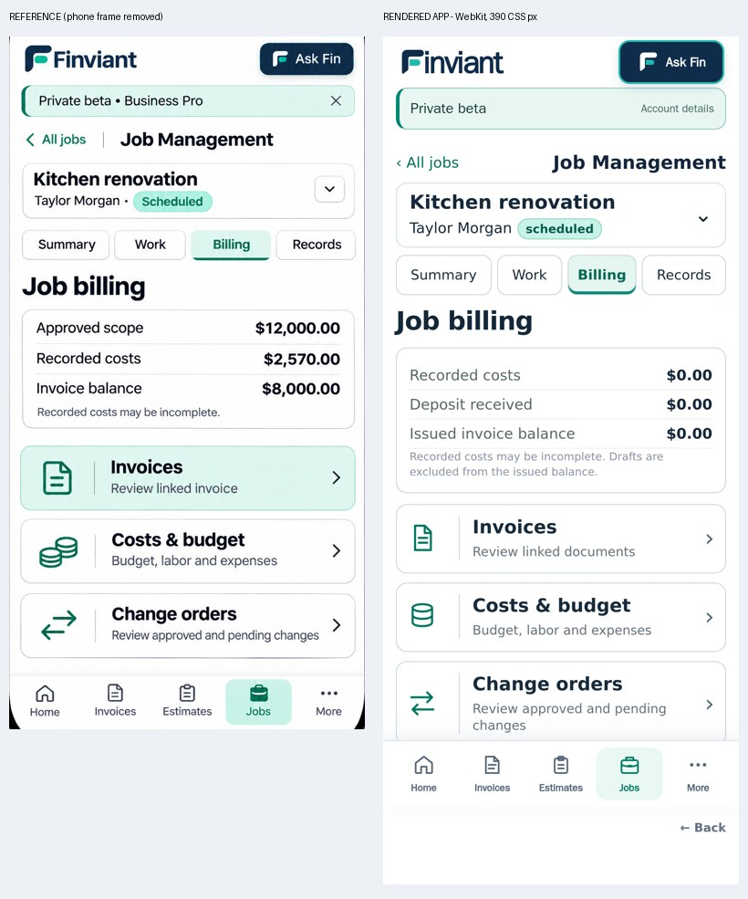

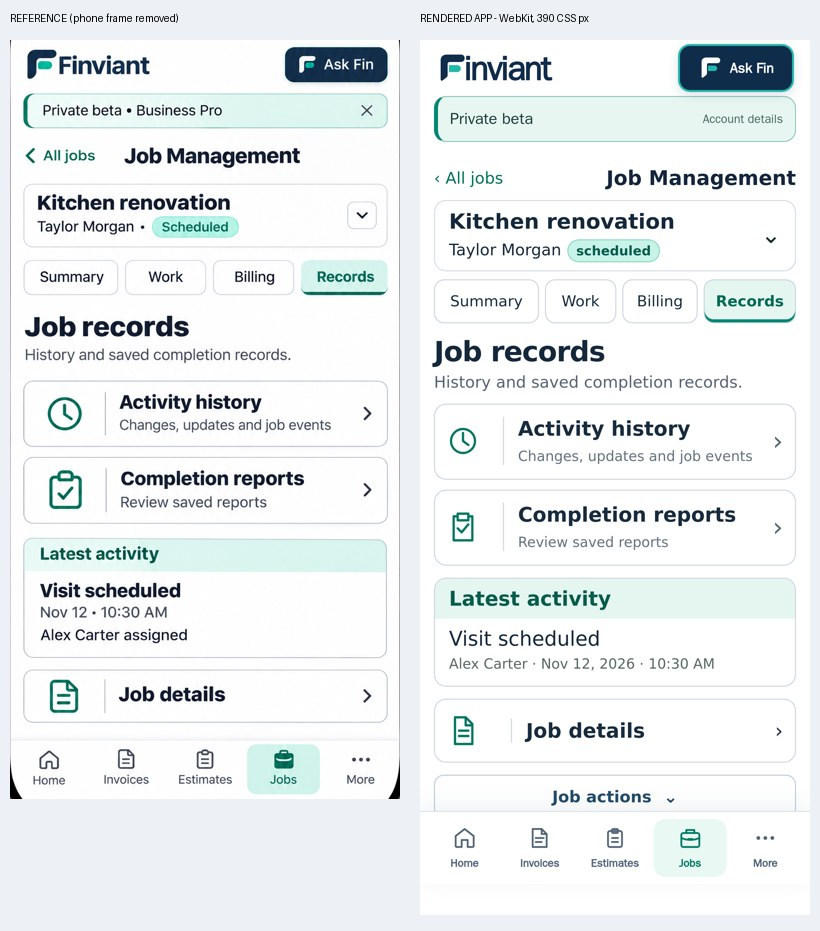

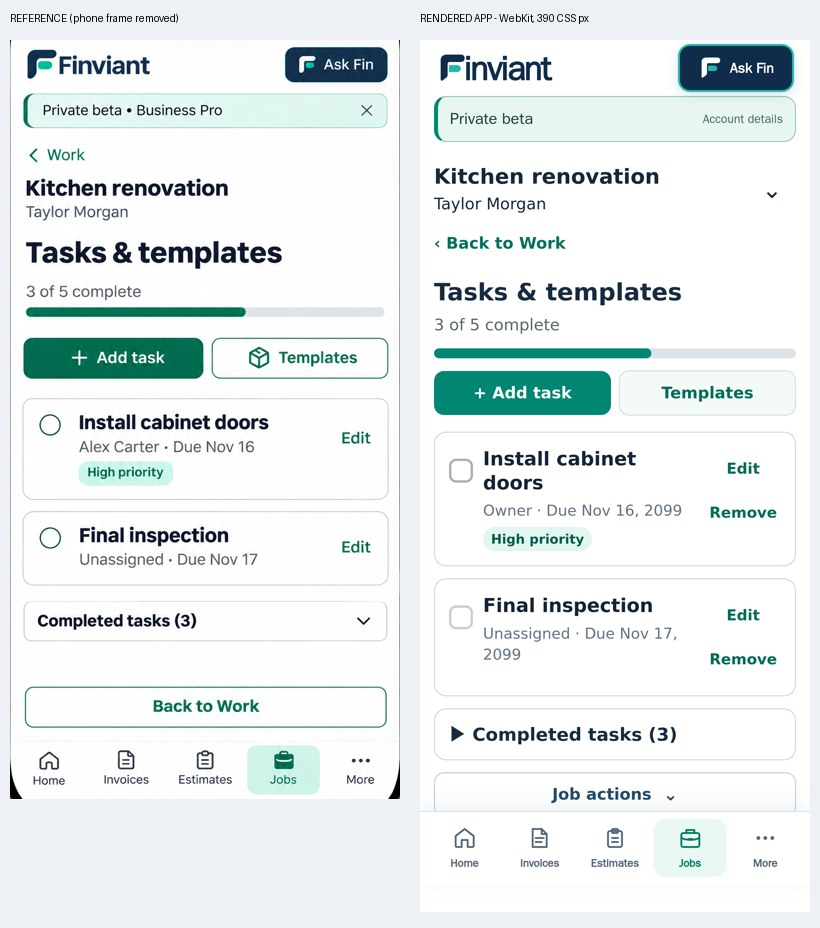

## Downstream screen comparisons

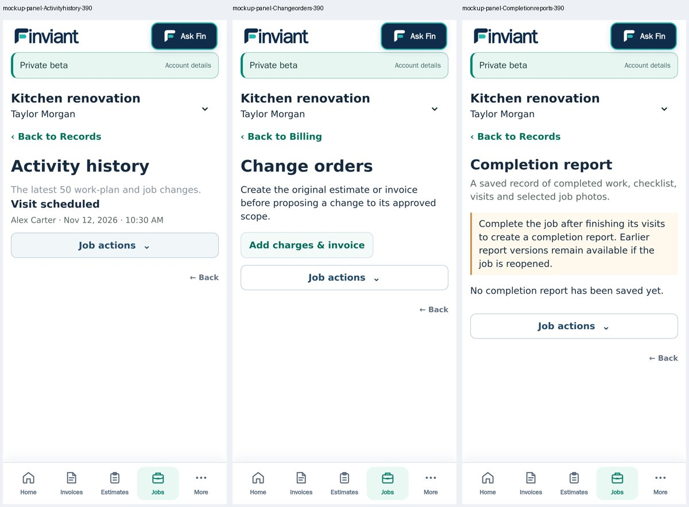

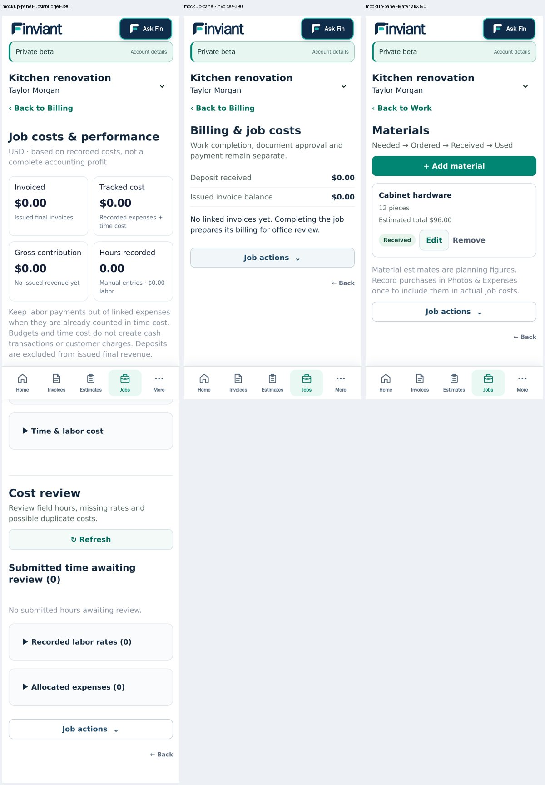

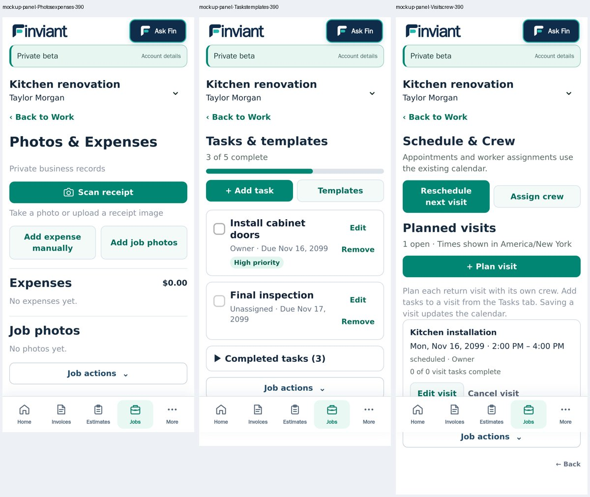

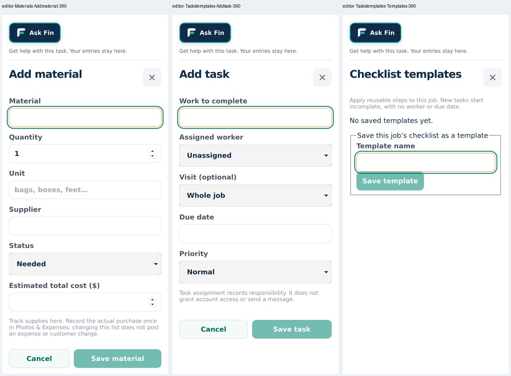

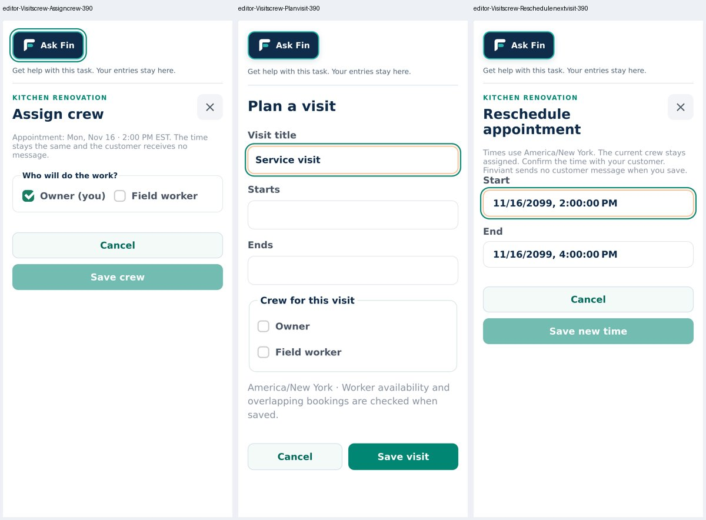

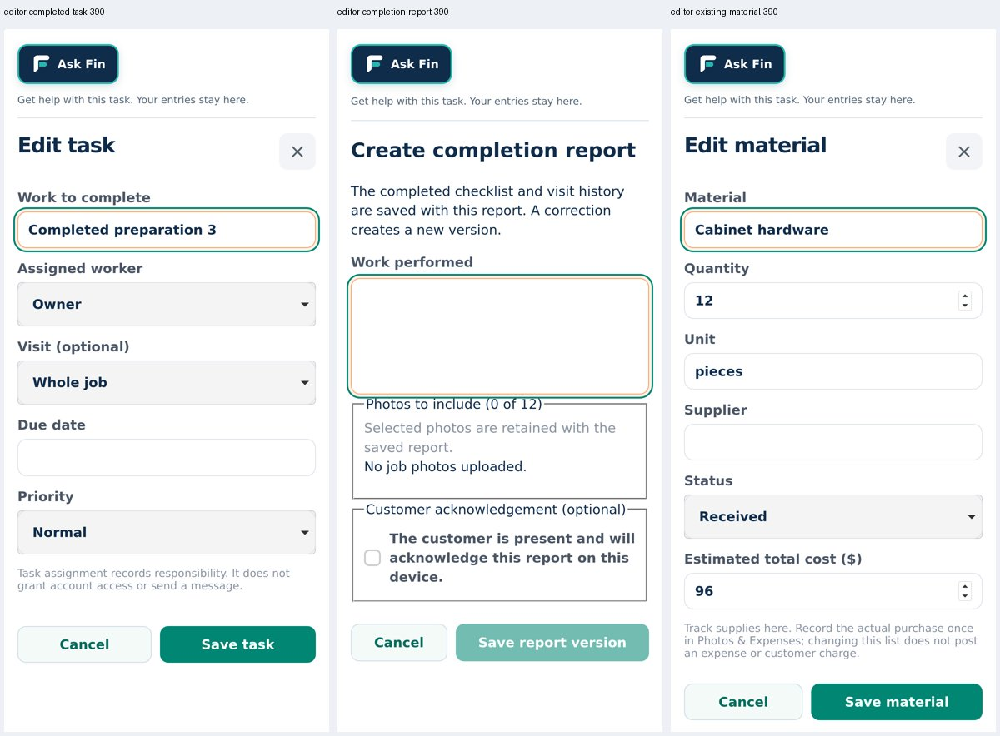

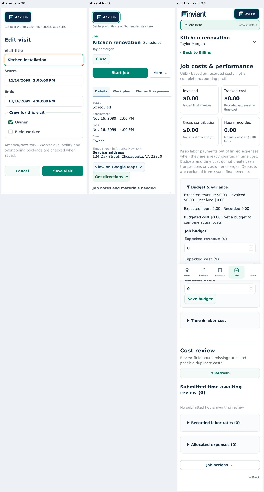

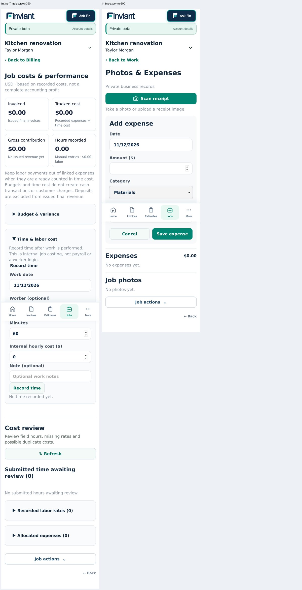

